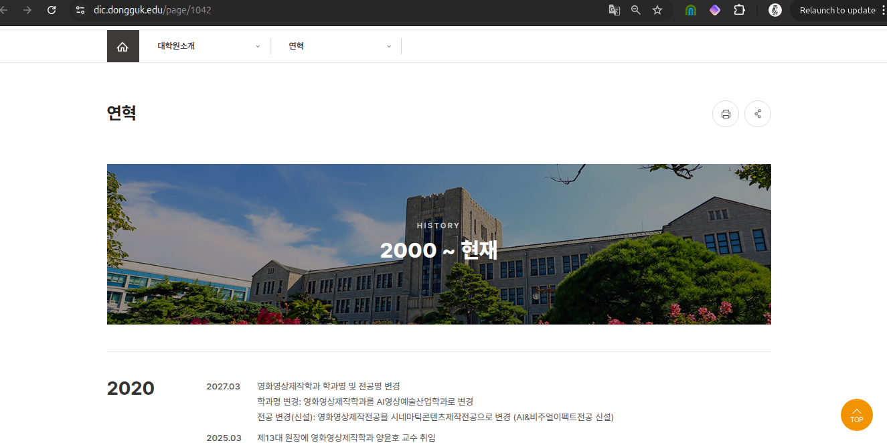

Dongguk University's graduate film department is being renamed from **영화영상제작학과** to **AI영상예술산업학과**. The graduate school's history page dates the formal change to **March 2027**.[^1] The new name was already in a school news headline on August 27, 2026,[^2] and on the faculty page by October 10, 2026.[^3]

If you are checking old records, news alerts, databases or partnership files, search every name below. Entries filed under an old name will not match a search for the new one.

The dates show when the evidence cited here was published or captured. They do not show when Dongguk first used a name.

## The department

| Name | What it is | Dated sources |
|---|---|---|
| **영화영상제작학과** | Korean name before the 2026 website change | News article, June 2020;[^4] history page entry dated 2025.03;[^1] news headline, December 2025;[^5] faculty page, July 25, 2025[^6] and April 1, 2026;[^7] monitor capture, October 3, 2026[^3] |
| **Department of Film and Digital Media** (also written "Film and Digital Media Studies") | Name on Dongguk's English-language department page. The page lists five professors who were also on the April 2026 영화영상제작학과 roster.[^7] | Archive captures of April 8, 2025,[^8] September 23, 2025[^9] and April 2, 2026[^10] |
| **AI영상예술산업(영화영상제작)학과** | Combined old and new form in a school news headline | August 27, 2026[^2] |
| **AI영상예술산업학과** | New Korean name | Faculty page by October 10, 2026;[^3] history page entry dated 2027.03, captured October 12, 2026[^1] |

Gender Watchdog has also written the old name in English as "Department of Film and Video Production".[^11] The new name means roughly "AI Visual Arts Industry". That is our unofficial translation: this page does not yet cite an English name from Dongguk for the new department.

## The majors

The history page records the department rename and the changes to its majors in one entry:[^1]

> 2027.03 
> 영화영상제작학과 학과명 및 전공명 변경 
> 학과명 변경: 영화영상제작학과를 AI영상예술산업학과로 변경 
> 전공 변경(신설): 영화영상제작전공을 시네마틱콘텐츠제작전공으로 변경 (AI&비주얼이펙트전공 신설)

| Before | From March 2027 | Change |
|---|---|---|
| 영화영상제작전공 (Film and Video Production) | 시네마틱콘텐츠제작전공 (Cinematic Content Production) | Major renamed |
| — | AI&비주얼이펙트전공 (AI & Visual Effects) | New major |

The English glosses in this table are unofficial.

*Gender Watchdog screenshot of the history page, October 12, 2026. Source page: <a href="https://dic.dongguk.edu/page/1042">https://dic.dongguk.edu/page/1042</a>*

## The graduate school

The department belongs to Dongguk's graduate school known in Korean as **동국대학교 영상대학원**. Its Korean website is at <a href="https://dic.dongguk.edu/">https://dic.dongguk.edu/</a>.

| Name | Where it is used |
|---|---|
| **Graduate School of Digital Image & Contents** | Dongguk's English-language website[^10][^12] |
| **동국대학교 영상대학원** | Korean name[^13] |
| **Graduate School of Imaging** | Shorter English rendering used in Gender Watchdog's rename report |
| **映像大学院** · **影像研究生院** · **影像研究所** | Names used in Gender Watchdog's Japanese, Simplified Chinese and Traditional Chinese rename reports |

## A different department with a similar name

Dongguk's College of Arts has an undergraduate **영화영상학과**. It is not the graduate department on this page. A June 2026 article about a College of Arts memorandum of understanding describes that department as training specialists in AI-based film production and short-form content.[^14]

## Gender Watchdog reports

**The rename report**

- Same Faculty, New Sign: Dongguk Renames Its Film School as an AI Department (November 2026): <a href="https://blog.genderwatchdog.org/dongguk-film-school-ai-rename-label-ahead-of-capacity/">https://blog.genderwatchdog.org/dongguk-film-school-ai-rename-label-ahead-of-capacity/</a>
- 한국어: <a href="https://blog.genderwatchdog.org/ko-dongguk-film-school-ai-rename-label-ahead-of-capacity/" hreflang="ko">https://blog.genderwatchdog.org/ko-dongguk-film-school-ai-rename-label-ahead-of-capacity/</a>
- 日本語: <a href="https://blog.genderwatchdog.org/ja-dongguk-film-school-ai-rename-label-ahead-of-capacity/" hreflang="ja">https://blog.genderwatchdog.org/ja-dongguk-film-school-ai-rename-label-ahead-of-capacity/</a>
- 简体中文: <a href="https://blog.genderwatchdog.org/hans-dongguk-film-school-ai-rename-label-ahead-of-capacity/" hreflang="zh-CN">https://blog.genderwatchdog.org/hans-dongguk-film-school-ai-rename-label-ahead-of-capacity/</a>
- 繁體中文: <a href="https://blog.genderwatchdog.org/hant-dongguk-film-school-ai-rename-label-ahead-of-capacity/" hreflang="zh-TW">https://blog.genderwatchdog.org/hant-dongguk-film-school-ai-rename-label-ahead-of-capacity/</a>

**Earlier reports about this department and its faculty**

- Buddhist Mission, Criminal Dean: The Full Dongguk Record as BIFF 2026 Opens (October 2026): <a href="https://blog.genderwatchdog.org/dongguk-biff-2026-institutional-capture-full-record/">https://blog.genderwatchdog.org/dongguk-biff-2026-institutional-capture-full-record/</a>
- Two Profiles, Two Cleanup Tracks: Dongguk Scrubs Its Film Faculty Eight Days After the EU-Korea Research Summit (April 2026): <a href="https://blog.genderwatchdog.org/dongguk-faculty-purge-paper-faculty-eu-cleanup-april-2026/">https://blog.genderwatchdog.org/dongguk-faculty-purge-paper-faculty-eu-cleanup-april-2026/</a>
- From Indictment to Dean's Office: How Dongguk University Rewarded a Criminal Conviction with Promotions (February 2026): <a href="https://blog.genderwatchdog.org/from-indictment-to-deans-office-how-dongguk-university-rewarded-a-criminal-conviction-with-promotions/">https://blog.genderwatchdog.org/from-indictment-to-deans-office-how-dongguk-university-rewarded-a-criminal-conviction-with-promotions/</a>
- The Alleged Predatory Appointment and Government Cover-Up: How IEQAS Certification Enables Systematic Corporate-Academic Exploitation at Dongguk University (September 2025): <a href="https://blog.genderwatchdog.org/the-alleged-predatory-appointment-and-government-cover-up-how-ieqas-certification-enables-systematic-corporate-academic-exploitation-at-dongguk-university/">https://blog.genderwatchdog.org/the-alleged-predatory-appointment-and-government-cover-up-how-ieqas-certification-enables-systematic-corporate-academic-exploitation-at-dongguk-university/</a>
- Web Archive access to Dongguk University's professor profile listings and international partner institutions (January 2025): <a href="https://blog.genderwatchdog.org/web-archive-access-to-dongguk-universitys-professor-profile-listings-and-international-partner-institutions/">https://blog.genderwatchdog.org/web-archive-access-to-dongguk-universitys-professor-profile-listings-and-international-partner-institutions/</a>

## Sources

[^1]: Dongguk University graduate school history page, captured October 12, 2026. <a href="https://dic.dongguk.edu/page/1042">https://dic.dongguk.edu/page/1042</a> — Screenshot: <a href="https://raw.githubusercontent.com/Gender-Watchdog/evidence_repository/master/imgs/k-unis-audit/dongguk/20261123-dongguk-name-change-ai/dongguk-dic-history-page-rename-20261012.png">https://raw.githubusercontent.com/Gender-Watchdog/evidence_repository/master/imgs/k-unis-audit/dongguk/20261123-dongguk-name-change-ai/dongguk-dic-history-page-rename-20261012.png</a>

[^2]: Dongguk University graduate school news post, August 27, 2026, "AI영상예술산업(영화영상제작)학과 BK21국제학술대회." <a href="https://dic.dongguk.edu/article/awards/detail/214141">https://dic.dongguk.edu/article/awards/detail/214141</a>

[^3]: Visual Ping, monitoring job "dongguk-film-faculty-profiles-ko." Previous capture October 3, 2026 (old name); current capture October 10, 2026 (new name). <a href="https://visualping.io/diff/1101795837">https://visualping.io/diff/1101795837</a> — Screenshots: <a href="https://raw.githubusercontent.com/Gender-Watchdog/evidence_repository/master/imgs/k-unis-audit/dongguk/20261123-dongguk-name-change-ai/dongguk-visual-ping-previous-20261003-old-name.png">https://raw.githubusercontent.com/Gender-Watchdog/evidence_repository/master/imgs/k-unis-audit/dongguk/20261123-dongguk-name-change-ai/dongguk-visual-ping-previous-20261003-old-name.png</a> — <a href="https://raw.githubusercontent.com/Gender-Watchdog/evidence_repository/master/imgs/k-unis-audit/dongguk/20261123-dongguk-name-change-ai/dongguk-visual-ping-current-20261010-new-name.png">https://raw.githubusercontent.com/Gender-Watchdog/evidence_repository/master/imgs/k-unis-audit/dongguk/20261123-dongguk-name-change-ai/dongguk-visual-ping-current-20261010-new-name.png</a>

[^4]: *대학저널* (백두산), "동국대 예술대학‧영상대학원 교수 일동, 코로나19 극복 장학금 전달" (June 5, 2020). <a href="https://dhnews.co.kr/news/view/179521225454502">https://dhnews.co.kr/news/view/179521225454502</a>

[^5]: *더퍼블릭* (김미희), "동국대학교 영화영상제작학과 교수 일동, 동국대에 발전기금 1000만 원 전달" (December 1, 2025). <a href="https://www.thepublic.kr/news/articleView.html?idxno=285594">https://www.thepublic.kr/news/articleView.html?idxno=285594</a> — Archive: <a href="https://web.archive.org/web/20261123112612/https://www.thepublic.kr/news/articleView.html?idxno=285594">https://web.archive.org/web/20261123112612/https://www.thepublic.kr/news/articleView.html?idxno=285594</a>

[^6]: Wayback Machine, Dongguk graduate school faculty page, July 25, 2025 capture. <a href="https://web.archive.org/web/20250725004358/https://dic.dongguk.edu/professor/list?professor_haggwa_type=PROFH_088">https://web.archive.org/web/20250725004358/https://dic.dongguk.edu/professor/list?professor_haggwa_type=PROFH_088</a>

[^7]: Wayback Machine, Dongguk graduate school faculty page, April 1, 2026 capture. <a href="https://web.archive.org/web/20260401224055/https://dic.dongguk.edu/professor/list?professor_haggwa_type=PROFH_088">https://web.archive.org/web/20260401224055/https://dic.dongguk.edu/professor/list?professor_haggwa_type=PROFH_088</a>

[^8]: Wayback Machine, Dongguk English-language department page, April 8, 2025 capture. <a href="https://web.archive.org/web/20250408005624/https://www.dongguk.edu/eng/dandae/122#">https://web.archive.org/web/20250408005624/https://www.dongguk.edu/eng/dandae/122#</a>

[^9]: Wayback Machine, Dongguk English-language department page, September 23, 2025 capture. <a href="https://web.archive.org/web/20250923102637/https://www.dongguk.edu/eng/dandae/122#">https://web.archive.org/web/20250923102637/https://www.dongguk.edu/eng/dandae/122#</a>

[^10]: Wayback Machine, Dongguk English-language department page, April 2, 2026 capture, headed "Graduate School of Digital Image & Contents." <a href="https://web.archive.org/web/20260402004909/https://www.dongguk.edu/eng/dandae/122#">https://web.archive.org/web/20260402004909/https://www.dongguk.edu/eng/dandae/122#</a>

[^11]: Gender Watchdog, "Web Archive access to Dongguk University's professor profile listings and international partner institutions," listing a May 3, 2025 archive of the department's faculty directory under that English name. Archive: <a href="https://archive.md/wBY91">https://archive.md/wBY91</a>

[^12]: Dongguk University English website, Academics: "Graduate School of Digital Image & Contents" (live page, viewed November 2026). <a href="https://www.dongguk.edu/eng/dandae/422">https://www.dongguk.edu/eng/dandae/422</a>

[^13]: Gender Watchdog, "Two Profiles, Two Cleanup Tracks: Dongguk Scrubs Its Film Faculty Eight Days After the EU-Korea Research Summit" (April 2026), which gives the English and Korean names together. <a href="https://blog.genderwatchdog.org/dongguk-faculty-purge-paper-faculty-eu-cleanup-april-2026/">https://blog.genderwatchdog.org/dongguk-faculty-purge-paper-faculty-eu-cleanup-april-2026/</a>

[^14]: *대학저널* (이선용), "동국대, AI 콘텐츠 시대 선도할 글로벌 혁신 박차" (June 5, 2026). <a href="https://dhnews.co.kr/news/view/1065588068027320">https://dhnews.co.kr/news/view/1065588068027320</a>
