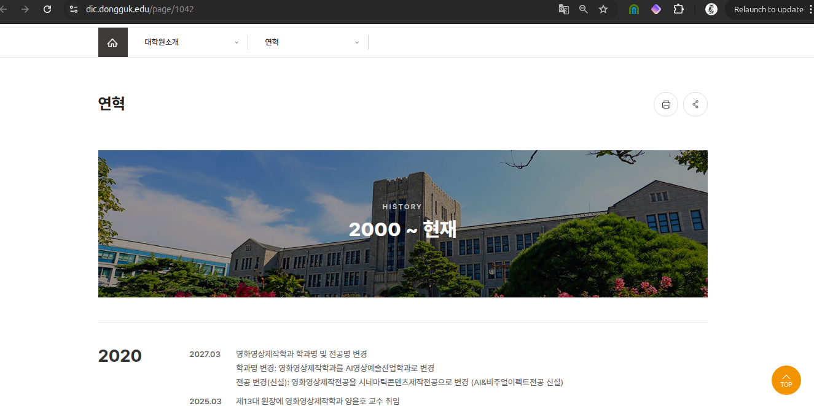

---
# Translation of dongguk-film-school-name-history.md. Bump last_modified_at on every content edit.
layout: evergreen
title: "东国大学 영화영상제작학과 → AI영상예술산업학과：学科名称沿革"
permalink: /hans-dongguk-film-school-name-history/
lang: zh-cn
translation_key: dongguk-film-school-name-history
reference_for: dongguk-ai-dept
last_modified_at: 2026-11-25T11:55:03Z
meta_description: "东国大学研究生院的电影相关学科 영화영상제작학과 将更名为 AI영상예술산업학과。本页整理该学科、其专业及研究生院的韩文与英文名称，并附注明日期的来源和存档链接。"
keywords: "东国大学, 영화영상제작학과, AI영상예술산업학과, AI영상예술산업(영화영상제작)학과, 学科更名, 影像研究生院, 电影研究生院, 시네마틱콘텐츠제작전공, 영화영상제작전공, AI&비주얼이펙트전공, Department of Film and Digital Media, Graduate School of Digital Image & Contents"
image: /assets/images/dongguk-ai-rename/dongguk-dic-history-page-rename-20261012.png
entities: [dongguk-ai-dept, dongguk-ai-vfx-major, dongguk-cinematic-content-major, dongguk-gsi, dongguk-university]
---

东国大学（Dongguk University）研究生院的电影相关学科正由 **영화영상제작학과** 更名为 **AI영상예술산업학과**。该研究生院的沿革页面记载，正式变更时间为 **2027年3月**。[^1] 新名称在2026年8月27日的研究生院新闻标题中已经出现，[^2] 到2026年10月10日也已用于教员页面。[^3]

如需核查以往记录、新闻提醒、数据库或合作文件，请用下列所有名称检索。按旧名称归档的条目，用新名称是检索不到的。

所列日期是本页引用的证据发布或存档的时间，并不表示东国大学首次使用某一名称的时间。

## 学科名称

| 名称 | 说明 | 注明日期的来源 |
|---|---|---|
| **영화영상제작학과** | 2026年网站变更前的韩文名称 | 2020年6月的新闻报道；[^4] 沿革页面中 2025.03 的条目；[^1] 2025年12月的新闻标题；[^5] 教员页面（2025年7月25日[^6]与2026年4月1日[^7]）；监测截图（2026年10月3日）[^3] |
| **Department of Film and Digital Media** （也写作「Film and Digital Media Studies」） | 东国大学英文学科页面使用的名称。该页面列出的教员中，有5人同样出现在2026年4月的 영화영상제작학과 名单上。[^7] | 2025年4月8日、[^8] 2025年9月23日[^9]和2026年4月2日[^10]的存档 |
| **AI영상예술산업(영화영상제작)학과** | 研究生院新闻标题中新旧并列的名称 | 2026年8月27日[^2] |
| **AI영상예술산업학과** | 新的韩文名称 | 截至2026年10月10日的教员页面；[^3] 2026年10月12日截取的沿革页面中 2027.03 的条目[^1] |

Gender Watchdog 也曾将旧名称用英文写作「Department of Film and Video Production」。[^11] 新名称的大意是「AI影像艺术产业学科」。这是本站的非官方翻译；本页目前尚未引用东国大学对该新学科的英文名称。

## 专业名称

沿革页面在同一条目中记载了学科更名和专业变更：[^1]

> 2027.03 
> 영화영상제작학과 학과명 및 전공명 변경 
> 학과명 변경: 영화영상제작학과를 AI영상예술산업학과로 변경 
> 전공 변경(신설): 영화영상제작전공을 시네마틱콘텐츠제작전공으로 변경 (AI&비주얼이펙트전공 신설)

| 变更前 | 自2027年3月起 | 类型 |
|---|---|---|
| 영화영상제작전공（电影影像制作） | 시네마틱콘텐츠제작전공（电影化内容制作） | 专业更名 |
| — | AI&비주얼이펙트전공（AI与视觉特效） | 新设专业 |

表中的中文译名均为非官方翻译。

*Gender Watchdog 于2026年10月12日截取的沿革页面。来源页面： <a href="https://dic.dongguk.edu/page/1042">https://dic.dongguk.edu/page/1042</a>*

## 研究生院名称

该学科所属研究生院的韩文名称为 **동국대학교 영상대학원**。其韩文网站： <a href="https://dic.dongguk.edu/">https://dic.dongguk.edu/</a>

| 名称 | 使用场合 |
|---|---|
| **Graduate School of Digital Image & Contents** | 东国大学英文网站[^10][^12] |
| **동국대학교 영상대학원** | 韩文名称[^13] |
| **Graduate School of Imaging** | Gender Watchdog 更名报道中使用的较短英文译名 |
| **映像大学院** · **影像研究生院** · **影像研究所** | Gender Watchdog 日文、简体中文和繁体中文更名报道中使用的名称 |

## 名称相近的另一个学科

东国大学艺术学院设有本科的 **영화영상학과**。它并非本页所述的研究生院学科。2026年6月一篇关于艺术学院合作备忘录的报道称，该学科培养基于AI的电影制作和短视频内容专业人才。[^14]

## Gender Watchdog 相关报道

**更名报道**

- 同一批教员，一块新招牌：东国大学将电影学院改名为AI学科（2026年11月）: <a href="https://blog.genderwatchdog.org/hans-dongguk-film-school-ai-rename-label-ahead-of-capacity/">https://blog.genderwatchdog.org/hans-dongguk-film-school-ai-rename-label-ahead-of-capacity/</a>
- English: <a href="https://blog.genderwatchdog.org/dongguk-film-school-ai-rename-label-ahead-of-capacity/" hreflang="en">https://blog.genderwatchdog.org/dongguk-film-school-ai-rename-label-ahead-of-capacity/</a>

**此前关于该学科及其教员的报道**

- 两份档案，两条清理轨迹：东国大学在韩欧研究峰会八天后清除了其电影学院教师名单（2026年4月）: <a href="https://blog.genderwatchdog.org/dongguk-faculty-purge-paper-faculty-eu-cleanup-april-2026-zh-cn/">https://blog.genderwatchdog.org/dongguk-faculty-purge-paper-faculty-eu-cleanup-april-2026-zh-cn/</a>
- 遭质疑的掠夺性任用与政府掩盖：IEQAS 认证如何促成东国大学系统性企业—学界剥削（2025年9月）: <a href="https://blog.genderwatchdog.org/the-alleged-predatory-appointment-and-government-cover-up-how-ieqas-certification-enables-systematic-corporate-academic-exploitation-at-dongguk-university-hans/">https://blog.genderwatchdog.org/the-alleged-predatory-appointment-and-government-cover-up-how-ieqas-certification-enables-systematic-corporate-academic-exploitation-at-dongguk-university-hans/</a>
- Buddhist Mission, Criminal Dean: The Full Dongguk Record as BIFF 2026 Opens（2026年10月，英文）: <a href="https://blog.genderwatchdog.org/dongguk-biff-2026-institutional-capture-full-record/" hreflang="en">https://blog.genderwatchdog.org/dongguk-biff-2026-institutional-capture-full-record/</a>
- From Indictment to Dean's Office: How Dongguk University Rewarded a Criminal Conviction with Promotions（2026年2月，英文）: <a href="https://blog.genderwatchdog.org/from-indictment-to-deans-office-how-dongguk-university-rewarded-a-criminal-conviction-with-promotions/" hreflang="en">https://blog.genderwatchdog.org/from-indictment-to-deans-office-how-dongguk-university-rewarded-a-criminal-conviction-with-promotions/</a>
- Web Archive access to Dongguk University's professor profile listings and international partner institutions（2025年1月，英文）: <a href="https://blog.genderwatchdog.org/web-archive-access-to-dongguk-universitys-professor-profile-listings-and-international-partner-institutions/" hreflang="en">https://blog.genderwatchdog.org/web-archive-access-to-dongguk-universitys-professor-profile-listings-and-international-partner-institutions/</a>

## 来源

[^1]: 东国大学研究生院沿革页面，2026年10月12日截取。 <a href="https://dic.dongguk.edu/page/1042">https://dic.dongguk.edu/page/1042</a> — 截图: <a href="https://raw.githubusercontent.com/Gender-Watchdog/evidence_repository/master/imgs/k-unis-audit/dongguk/20261123-dongguk-name-change-ai/dongguk-dic-history-page-rename-20261012.png">https://raw.githubusercontent.com/Gender-Watchdog/evidence_repository/master/imgs/k-unis-audit/dongguk/20261123-dongguk-name-change-ai/dongguk-dic-history-page-rename-20261012.png</a>

[^2]: 东国大学研究生院新闻，2026年8月27日， "AI영상예술산업(영화영상제작)학과 BK21국제학술대회." <a href="https://dic.dongguk.edu/article/awards/detail/214141">https://dic.dongguk.edu/article/awards/detail/214141</a>

[^3]: Visual Ping 监测任务「dongguk-film-faculty-profiles-ko」。变更前截图为2026年10月3日（旧名称），变更后截图为2026年10月10日（新名称）。 <a href="https://visualping.io/diff/1101795837">https://visualping.io/diff/1101795837</a> — 截图: <a href="https://raw.githubusercontent.com/Gender-Watchdog/evidence_repository/master/imgs/k-unis-audit/dongguk/20261123-dongguk-name-change-ai/dongguk-visual-ping-previous-20261003-old-name.png">https://raw.githubusercontent.com/Gender-Watchdog/evidence_repository/master/imgs/k-unis-audit/dongguk/20261123-dongguk-name-change-ai/dongguk-visual-ping-previous-20261003-old-name.png</a> — <a href="https://raw.githubusercontent.com/Gender-Watchdog/evidence_repository/master/imgs/k-unis-audit/dongguk/20261123-dongguk-name-change-ai/dongguk-visual-ping-current-20261010-new-name.png">https://raw.githubusercontent.com/Gender-Watchdog/evidence_repository/master/imgs/k-unis-audit/dongguk/20261123-dongguk-name-change-ai/dongguk-visual-ping-current-20261010-new-name.png</a>

[^4]: *대학저널* (백두산), "동국대 예술대학‧영상대학원 교수 일동, 코로나19 극복 장학금 전달" (2020年6月5日). <a href="https://dhnews.co.kr/news/view/179521225454502">https://dhnews.co.kr/news/view/179521225454502</a>

[^5]: *더퍼블릭* (김미희), "동국대학교 영화영상제작학과 교수 일동, 동국대에 발전기금 1000만 원 전달" (2025年12月1日). <a href="https://www.thepublic.kr/news/articleView.html?idxno=285594">https://www.thepublic.kr/news/articleView.html?idxno=285594</a> — 存档: <a href="https://web.archive.org/web/20261123112612/https://www.thepublic.kr/news/articleView.html?idxno=285594">https://web.archive.org/web/20261123112612/https://www.thepublic.kr/news/articleView.html?idxno=285594</a>

[^6]: Wayback Machine，东国大学研究生院教员页面，2025年7月25日存档。 <a href="https://web.archive.org/web/20250725004358/https://dic.dongguk.edu/professor/list?professor_haggwa_type=PROFH_088">https://web.archive.org/web/20250725004358/https://dic.dongguk.edu/professor/list?professor_haggwa_type=PROFH_088</a>

[^7]: Wayback Machine，东国大学研究生院教员页面，2026年4月1日存档。 <a href="https://web.archive.org/web/20260401224055/https://dic.dongguk.edu/professor/list?professor_haggwa_type=PROFH_088">https://web.archive.org/web/20260401224055/https://dic.dongguk.edu/professor/list?professor_haggwa_type=PROFH_088</a>

[^8]: Wayback Machine，东国大学英文学科页面，2025年4月8日存档。 <a href="https://web.archive.org/web/20250408005624/https://www.dongguk.edu/eng/dandae/122#">https://web.archive.org/web/20250408005624/https://www.dongguk.edu/eng/dandae/122#</a>

[^9]: Wayback Machine，东国大学英文学科页面，2025年9月23日存档。 <a href="https://web.archive.org/web/20250923102637/https://www.dongguk.edu/eng/dandae/122#">https://web.archive.org/web/20250923102637/https://www.dongguk.edu/eng/dandae/122#</a>

[^10]: Wayback Machine，东国大学英文学科页面，2026年4月2日存档，页首标题为「Graduate School of Digital Image & Contents」。 <a href="https://web.archive.org/web/20260402004909/https://www.dongguk.edu/eng/dandae/122#">https://web.archive.org/web/20260402004909/https://www.dongguk.edu/eng/dandae/122#</a>

[^11]: Gender Watchdog，"Web Archive access to Dongguk University's professor profile listings and international partner institutions"。文中以该英文名称列出2025年5月3日存档的该学科教员名录。 存档: <a href="https://archive.md/wBY91">https://archive.md/wBY91</a>

[^12]: 东国大学英文网站，Academics：「Graduate School of Digital Image & Contents」（现行页面，2026年11月查阅）。 <a href="https://www.dongguk.edu/eng/dandae/422">https://www.dongguk.edu/eng/dandae/422</a>

[^13]: Gender Watchdog，"Two Profiles, Two Cleanup Tracks: Dongguk Scrubs Its Film Faculty Eight Days After the EU-Korea Research Summit"（2026年4月）。文中并列给出英文名称与韩文名称。 <a href="https://blog.genderwatchdog.org/dongguk-faculty-purge-paper-faculty-eu-cleanup-april-2026/">https://blog.genderwatchdog.org/dongguk-faculty-purge-paper-faculty-eu-cleanup-april-2026/</a>

[^14]: *대학저널* (이선용), "동국대, AI 콘텐츠 시대 선도할 글로벌 혁신 박차" (2026年6月5日). <a href="https://dhnews.co.kr/news/view/1065588068027320">https://dhnews.co.kr/news/view/1065588068027320</a>
