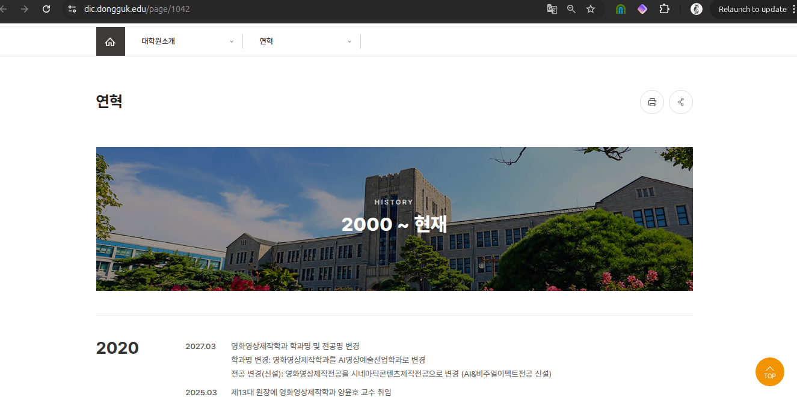

---
# Translation of dongguk-film-school-name-history.md. Bump last_modified_at on every content edit.
layout: evergreen
title: "東國大學 영화영상제작학과 → AI영상예술산업학과：學系名稱沿革"
permalink: /hant-dongguk-film-school-name-history/
lang: zh-tw
translation_key: dongguk-film-school-name-history
reference_for: dongguk-ai-dept
last_modified_at: 2026-11-25T11:55:03Z
meta_description: "東國大學研究所的電影相關學系 영화영상제작학과 將更名為 AI영상예술산업학과。本頁整理該學系、其專業及研究所的韓文與英文名稱，並附註明日期的來源和存檔連結。"
keywords: "東國大學, 영화영상제작학과, AI영상예술산업학과, AI영상예술산업(영화영상제작)학과, 學系更名, 影像研究所, 電影研究所, 시네마틱콘텐츠제작전공, 영화영상제작전공, AI&비주얼이펙트전공, Department of Film and Digital Media, Graduate School of Digital Image & Contents"
image: /assets/images/dongguk-ai-rename/dongguk-dic-history-page-rename-20261012.png
entities: [dongguk-ai-dept, dongguk-ai-vfx-major, dongguk-cinematic-content-major, dongguk-gsi, dongguk-university]
---

東國大學（Dongguk University）研究所的電影相關學系正由 **영화영상제작학과** 更名為 **AI영상예술산업학과**。該研究所的沿革頁面記載，正式變更時間為 **2027年3月**。[^1] 新名稱在2026年8月27日的研究所新聞標題中已經出現，[^2] 到2026年10月10日也已用於教員頁面。[^3]

如需查核以往紀錄、新聞快訊、資料庫或合作文件，請用下列所有名稱搜尋。以舊名稱歸檔的項目，用新名稱是搜尋不到的。

所列日期是本頁引用的證據發布或存檔的時間，並不代表東國大學首次使用某一名稱的時間。

## 學系名稱

| 名稱 | 說明 | 註明日期的來源 |
|---|---|---|
| **영화영상제작학과** | 2026年網站變更前的韓文名稱 | 2020年6月的新聞報導；[^4] 沿革頁面中 2025.03 的條目；[^1] 2025年12月的新聞標題；[^5] 教員頁面（2025年7月25日[^6]與2026年4月1日[^7]）；監測截圖（2026年10月3日）[^3] |
| **Department of Film and Digital Media** （也寫作「Film and Digital Media Studies」） | 東國大學英文學系頁面使用的名稱。該頁面列出的教員中，有5位同樣出現在2026年4月的 영화영상제작학과 名單上。[^7] | 2025年4月8日、[^8] 2025年9月23日[^9]和2026年4月2日[^10]的存檔 |
| **AI영상예술산업(영화영상제작)학과** | 研究所新聞標題中新舊並列的名稱 | 2026年8月27日[^2] |
| **AI영상예술산업학과** | 新的韓文名稱 | 截至2026年10月10日的教員頁面；[^3] 2026年10月12日擷取的沿革頁面中 2027.03 的條目[^1] |

Gender Watchdog 也曾將舊名稱以英文寫作「Department of Film and Video Production」。[^11] 新名稱的大意是「AI影像藝術產業學系」。這是本站的非官方翻譯；本頁目前尚未引用東國大學對該新學系的英文名稱。

## 專業名稱

沿革頁面在同一條目中記載了學系更名和專業變更：[^1]

> 2027.03 
> 영화영상제작학과 학과명 및 전공명 변경 
> 학과명 변경: 영화영상제작학과를 AI영상예술산업학과로 변경 
> 전공 변경(신설): 영화영상제작전공을 시네마틱콘텐츠제작전공으로 변경 (AI&비주얼이펙트전공 신설)

| 變更前 | 自2027年3月起 | 類型 |
|---|---|---|
| 영화영상제작전공（電影影像製作） | 시네마틱콘텐츠제작전공（電影化內容製作） | 專業更名 |
| — | AI&비주얼이펙트전공（AI與視覺特效） | 新設專業 |

表中的中文譯名均為非官方翻譯。

*Gender Watchdog 於2026年10月12日擷取的沿革頁面。來源頁面： <a href="https://dic.dongguk.edu/page/1042">https://dic.dongguk.edu/page/1042</a>*

## 研究所名稱

該學系所屬研究所的韓文名稱為 **동국대학교 영상대학원**。其韓文網站： <a href="https://dic.dongguk.edu/">https://dic.dongguk.edu/</a>

| 名稱 | 使用場合 |
|---|---|
| **Graduate School of Digital Image & Contents** | 東國大學英文網站[^10][^12] |
| **동국대학교 영상대학원** | 韓文名稱[^13] |
| **Graduate School of Imaging** | Gender Watchdog 更名報導中使用的較短英文譯名 |
| **映像大学院** · **影像研究生院** · **影像研究所** | Gender Watchdog 日文、簡體中文和繁體中文更名報導中使用的名稱 |

## 名稱相近的另一個學系

東國大學藝術學院設有大學部的 **영화영상학과**。它並非本頁所述的研究所學系。2026年6月一篇關於藝術學院合作備忘錄的報導稱，該學系培育以AI為基礎的電影製作和短影音內容專業人才。[^14]

## Gender Watchdog 相關報導

**更名報導**

- 同一批教員，換上新招牌：東國大學將電影學院改名為AI學系（2026年11月）: <a href="https://blog.genderwatchdog.org/hant-dongguk-film-school-ai-rename-label-ahead-of-capacity/">https://blog.genderwatchdog.org/hant-dongguk-film-school-ai-rename-label-ahead-of-capacity/</a>
- English: <a href="https://blog.genderwatchdog.org/dongguk-film-school-ai-rename-label-ahead-of-capacity/" hreflang="en">https://blog.genderwatchdog.org/dongguk-film-school-ai-rename-label-ahead-of-capacity/</a>

**此前關於該學系及其教員的報導**

- 兩份檔案，兩條清理軌跡：東國大學在韓歐研究峰會八天後清除了其電影學院教師名單（2026年4月）: <a href="https://blog.genderwatchdog.org/dongguk-faculty-purge-paper-faculty-eu-cleanup-april-2026-zh-tw/">https://blog.genderwatchdog.org/dongguk-faculty-purge-paper-faculty-eu-cleanup-april-2026-zh-tw/</a>
- 遭質疑的掠奪性任用與政府掩蓋：IEQAS 認證如何促成東國大學系統性企業—學界剝削（2025年9月）: <a href="https://blog.genderwatchdog.org/ieqas-link-the-alleged-predatory-appointment-and-government-cover-up-how-ieqas-certification-enables-systematic-corporate-academic-exploitation-at-dongguk-university-hant/">https://blog.genderwatchdog.org/ieqas-link-the-alleged-predatory-appointment-and-government-cover-up-how-ieqas-certification-enables-systematic-corporate-academic-exploitation-at-dongguk-university-hant/</a>
- Buddhist Mission, Criminal Dean: The Full Dongguk Record as BIFF 2026 Opens（2026年10月，英文）: <a href="https://blog.genderwatchdog.org/dongguk-biff-2026-institutional-capture-full-record/" hreflang="en">https://blog.genderwatchdog.org/dongguk-biff-2026-institutional-capture-full-record/</a>
- From Indictment to Dean's Office: How Dongguk University Rewarded a Criminal Conviction with Promotions（2026年2月，英文）: <a href="https://blog.genderwatchdog.org/from-indictment-to-deans-office-how-dongguk-university-rewarded-a-criminal-conviction-with-promotions/" hreflang="en">https://blog.genderwatchdog.org/from-indictment-to-deans-office-how-dongguk-university-rewarded-a-criminal-conviction-with-promotions/</a>
- Web Archive access to Dongguk University's professor profile listings and international partner institutions（2025年1月，英文）: <a href="https://blog.genderwatchdog.org/web-archive-access-to-dongguk-universitys-professor-profile-listings-and-international-partner-institutions/" hreflang="en">https://blog.genderwatchdog.org/web-archive-access-to-dongguk-universitys-professor-profile-listings-and-international-partner-institutions/</a>

## 來源

[^1]: 東國大學研究所沿革頁面，2026年10月12日擷取。 <a href="https://dic.dongguk.edu/page/1042">https://dic.dongguk.edu/page/1042</a> — 截圖: <a href="https://raw.githubusercontent.com/Gender-Watchdog/evidence_repository/master/imgs/k-unis-audit/dongguk/20261123-dongguk-name-change-ai/dongguk-dic-history-page-rename-20261012.png">https://raw.githubusercontent.com/Gender-Watchdog/evidence_repository/master/imgs/k-unis-audit/dongguk/20261123-dongguk-name-change-ai/dongguk-dic-history-page-rename-20261012.png</a>

[^2]: 東國大學研究所新聞，2026年8月27日， "AI영상예술산업(영화영상제작)학과 BK21국제학술대회." <a href="https://dic.dongguk.edu/article/awards/detail/214141">https://dic.dongguk.edu/article/awards/detail/214141</a>

[^3]: Visual Ping 監測任務「dongguk-film-faculty-profiles-ko」。變更前截圖為2026年10月3日（舊名稱），變更後截圖為2026年10月10日（新名稱）。 <a href="https://visualping.io/diff/1101795837">https://visualping.io/diff/1101795837</a> — 截圖: <a href="https://raw.githubusercontent.com/Gender-Watchdog/evidence_repository/master/imgs/k-unis-audit/dongguk/20261123-dongguk-name-change-ai/dongguk-visual-ping-previous-20261003-old-name.png">https://raw.githubusercontent.com/Gender-Watchdog/evidence_repository/master/imgs/k-unis-audit/dongguk/20261123-dongguk-name-change-ai/dongguk-visual-ping-previous-20261003-old-name.png</a> — <a href="https://raw.githubusercontent.com/Gender-Watchdog/evidence_repository/master/imgs/k-unis-audit/dongguk/20261123-dongguk-name-change-ai/dongguk-visual-ping-current-20261010-new-name.png">https://raw.githubusercontent.com/Gender-Watchdog/evidence_repository/master/imgs/k-unis-audit/dongguk/20261123-dongguk-name-change-ai/dongguk-visual-ping-current-20261010-new-name.png</a>

[^4]: *대학저널* (백두산), "동국대 예술대학‧영상대학원 교수 일동, 코로나19 극복 장학금 전달" (2020年6月5日). <a href="https://dhnews.co.kr/news/view/179521225454502">https://dhnews.co.kr/news/view/179521225454502</a>

[^5]: *더퍼블릭* (김미희), "동국대학교 영화영상제작학과 교수 일동, 동국대에 발전기금 1000만 원 전달" (2025年12月1日). <a href="https://www.thepublic.kr/news/articleView.html?idxno=285594">https://www.thepublic.kr/news/articleView.html?idxno=285594</a> — 存檔: <a href="https://web.archive.org/web/20261123112612/https://www.thepublic.kr/news/articleView.html?idxno=285594">https://web.archive.org/web/20261123112612/https://www.thepublic.kr/news/articleView.html?idxno=285594</a>

[^6]: Wayback Machine，東國大學研究所教員頁面，2025年7月25日存檔。 <a href="https://web.archive.org/web/20250725004358/https://dic.dongguk.edu/professor/list?professor_haggwa_type=PROFH_088">https://web.archive.org/web/20250725004358/https://dic.dongguk.edu/professor/list?professor_haggwa_type=PROFH_088</a>

[^7]: Wayback Machine，東國大學研究所教員頁面，2026年4月1日存檔。 <a href="https://web.archive.org/web/20260401224055/https://dic.dongguk.edu/professor/list?professor_haggwa_type=PROFH_088">https://web.archive.org/web/20260401224055/https://dic.dongguk.edu/professor/list?professor_haggwa_type=PROFH_088</a>

[^8]: Wayback Machine，東國大學英文學系頁面，2025年4月8日存檔。 <a href="https://web.archive.org/web/20250408005624/https://www.dongguk.edu/eng/dandae/122#">https://web.archive.org/web/20250408005624/https://www.dongguk.edu/eng/dandae/122#</a>

[^9]: Wayback Machine，東國大學英文學系頁面，2025年9月23日存檔。 <a href="https://web.archive.org/web/20250923102637/https://www.dongguk.edu/eng/dandae/122#">https://web.archive.org/web/20250923102637/https://www.dongguk.edu/eng/dandae/122#</a>

[^10]: Wayback Machine，東國大學英文學系頁面，2026年4月2日存檔，頁首標題為「Graduate School of Digital Image & Contents」。 <a href="https://web.archive.org/web/20260402004909/https://www.dongguk.edu/eng/dandae/122#">https://web.archive.org/web/20260402004909/https://www.dongguk.edu/eng/dandae/122#</a>

[^11]: Gender Watchdog，"Web Archive access to Dongguk University's professor profile listings and international partner institutions"。文中以該英文名稱列出2025年5月3日存檔的該學系教員名錄。 存檔: <a href="https://archive.md/wBY91">https://archive.md/wBY91</a>

[^12]: 東國大學英文網站，Academics：「Graduate School of Digital Image & Contents」（現行頁面，2026年11月查閱）。 <a href="https://www.dongguk.edu/eng/dandae/422">https://www.dongguk.edu/eng/dandae/422</a>

[^13]: Gender Watchdog，"Two Profiles, Two Cleanup Tracks: Dongguk Scrubs Its Film Faculty Eight Days After the EU-Korea Research Summit"（2026年4月）。文中並列給出英文名稱與韓文名稱。 <a href="https://blog.genderwatchdog.org/dongguk-faculty-purge-paper-faculty-eu-cleanup-april-2026/">https://blog.genderwatchdog.org/dongguk-faculty-purge-paper-faculty-eu-cleanup-april-2026/</a>

[^14]: *대학저널* (이선용), "동국대, AI 콘텐츠 시대 선도할 글로벌 혁신 박차" (2026年6月5日). <a href="https://dhnews.co.kr/news/view/1065588068027320">https://dhnews.co.kr/news/view/1065588068027320</a>
