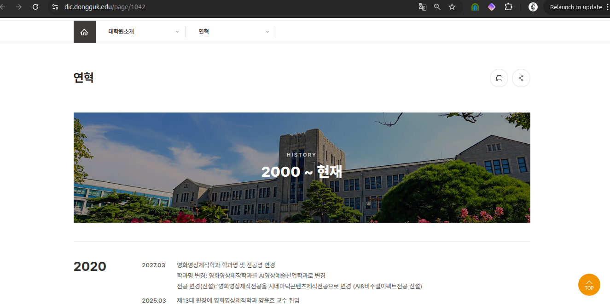

---
# Translation of dongguk-film-school-name-history.md. Bump last_modified_at on every content edit.
layout: evergreen
title: "東国大学 영화영상제작학과 → AI영상예술산업학과：学科名の変遷"
permalink: /ja-dongguk-film-school-name-history/
lang: ja
translation_key: dongguk-film-school-name-history
reference_for: dongguk-ai-dept
last_modified_at: 2026-11-25T11:55:03Z
meta_description: "東国大学の大学院の映画系学科 영화영상제작학과 は AI영상예술산업학과 に改称されます。学科・専攻・大学院の韓国語名と英語名を、日付のある出典とアーカイブリンク付きでまとめました。"
keywords: "東国大学, 영화영상제작학과, AI영상예술산업학과, AI영상예술산업(영화영상제작)학과, 学科改称, 映像大学院, 映画大学院, 시네마틱콘텐츠제작전공, 영화영상제작전공, AI&비주얼이펙트전공, Department of Film and Digital Media, Graduate School of Digital Image & Contents"
image: /assets/images/dongguk-ai-rename/dongguk-dic-history-page-rename-20261012.png
entities: [dongguk-ai-dept, dongguk-ai-vfx-major, dongguk-cinematic-content-major, dongguk-gsi, dongguk-university]
---

東国大学（Dongguk University）の大学院の映画系学科は、**영화영상제작학과** から **AI영상예술산업학과** に改称されます。大学院の沿革ページは、正式な変更時期を **2027年3月** と記載しています。[^1] 新名称は2026年8月27日の大学院ニュースの見出しにすでに使われており、[^2] 2026年10月10日には教員ページにも反映されていました。[^3]

過去の記録、ニュースアラート、データベース、提携文書を確認する場合は、以下のすべての名称で検索してください。旧名称で登録された情報は、新名称で検索しても見つかりません。

日付は、ここで引用する資料が公開または保存された時点を示すものです。東国大学がその名称を最初に使った日を示すものではありません。

## 学科名

| 名称 | 説明 | 日付のある出典 |
|---|---|---|
| **영화영상제작학과** | 2026年のウェブサイト変更前の韓国語名称 | 2020年6月の記事、[^4] 沿革ページの2025.03の項目、[^1] 2025年12月の記事見出し、[^5] 教員ページ（2025年7月25日[^6]と2026年4月1日[^7]）、監視キャプチャ（2026年10月3日）[^3] |
| **Department of Film and Digital Media** （「Film and Digital Media Studies」の表記もあり） | 東国大学の英語版学科ページの名称。同ページに掲載された教員のうち5人は、2026年4月の 영화영상제작학과 の名簿にも載っていました。[^7] | 2025年4月8日、[^8] 2025年9月23日、[^9] 2026年4月2日[^10]のアーカイブ |
| **AI영상예술산업(영화영상제작)학과** | 大学院ニュースの見出しで使われた新旧併記の名称 | 2026年8月27日[^2] |
| **AI영상예술산업학과** | 新しい韓国語名称 | 2026年10月10日時点の教員ページ、[^3] 2026年10月12日に保存した沿革ページの2027.03の項目[^1] |

Gender Watchdog は旧名称を英語で「Department of Film and Video Production」と表記したこともあります。[^11] 新名称はおおよそ「AI映像芸術産業学科」という意味です。これは当サイトによる非公式の訳であり、このページでは東国大学による新学科の英語名称はまだ引用していません。

## 専攻名

沿革ページは、学科名の変更と専攻の変更を一つの項目に記載しています。[^1]

> 2027.03 
> 영화영상제작학과 학과명 및 전공명 변경 
> 학과명 변경: 영화영상제작학과를 AI영상예술산업학과로 변경 
> 전공 변경(신설): 영화영상제작전공을 시네마틱콘텐츠제작전공으로 변경 (AI&비주얼이펙트전공 신설)

| 変更前 | 2027年3月から | 区分 |
|---|---|---|
| 영화영상제작전공（映画映像制作） | 시네마틱콘텐츠제작전공（シネマティックコンテンツ制作） | 専攻名の変更 |
| — | AI&비주얼이펙트전공（AI＆ビジュアルエフェクト） | 新設 |

表中の日本語訳は非公式のものです。

*Gender Watchdog が2026年10月12日に撮影した沿革ページのスクリーンショット。出典ページ： <a href="https://dic.dongguk.edu/page/1042">https://dic.dongguk.edu/page/1042</a>*

## 大学院名

この学科が属する大学院の韓国語名称は **동국대학교 영상대학원** です。韓国語版ウェブサイト： <a href="https://dic.dongguk.edu/">https://dic.dongguk.edu/</a>

| 名称 | 使われている場所 |
|---|---|
| **Graduate School of Digital Image & Contents** | 東国大学の英語版ウェブサイト[^10][^12] |
| **동국대학교 영상대학원** | 韓国語名称[^13] |
| **Graduate School of Imaging** | Gender Watchdog の改称レポートで使った短い英語表記 |
| **映像大学院** · **影像研究生院** · **影像研究所** | Gender Watchdog の日本語・簡体字中国語・繁体字中国語の改称レポートで使った名称 |

## よく似た名称の別の学科

東国大学の芸術大学には、学部の **영화영상학과** があります。このページで扱う大学院の学科とは別の学科です。芸術大学の協定（MOU）を報じた2026年6月の記事は、この学科がAIを活用した映画制作とショートフォームコンテンツの専門人材を育成すると紹介しています。[^14]

## Gender Watchdog の関連記事

**改称レポート**

- 教員は同じ、看板だけ新しく：東国大学が映画学科をAI学科に改称（2026年11月）: <a href="https://blog.genderwatchdog.org/ja-dongguk-film-school-ai-rename-label-ahead-of-capacity/">https://blog.genderwatchdog.org/ja-dongguk-film-school-ai-rename-label-ahead-of-capacity/</a>
- English: <a href="https://blog.genderwatchdog.org/dongguk-film-school-ai-rename-label-ahead-of-capacity/" hreflang="en">https://blog.genderwatchdog.org/dongguk-film-school-ai-rename-label-ahead-of-capacity/</a>

**この学科と教員に関する過去の記事**

- 2つのプロファイル、2つのクリーンアップの軌跡：東国大学が日・EU研究サミットの8日後に映画映像学科の教員名簿を消去（2026年4月）: <a href="https://blog.genderwatchdog.org/dongguk-faculty-purge-paper-faculty-eu-cleanup-april-2026-ja/">https://blog.genderwatchdog.org/dongguk-faculty-purge-paper-faculty-eu-cleanup-april-2026-ja/</a>
- 疑惑の「捕食的任用」：Sidus FNH CEOのチャ・スンジェはどのように企業影響力を用いて東国大学で学生への直接アクセスを確保したのか（2025年9月）: <a href="https://blog.genderwatchdog.org/the-alleged-predatory-appointment-and-government-cover-up-how-ieqas-certification-enables-systematic-corporate-academic-exploitation-at-dongguk-university-ja/">https://blog.genderwatchdog.org/the-alleged-predatory-appointment-and-government-cover-up-how-ieqas-certification-enables-systematic-corporate-academic-exploitation-at-dongguk-university-ja/</a>
- Buddhist Mission, Criminal Dean: The Full Dongguk Record as BIFF 2026 Opens（2026年10月、英語）: <a href="https://blog.genderwatchdog.org/dongguk-biff-2026-institutional-capture-full-record/" hreflang="en">https://blog.genderwatchdog.org/dongguk-biff-2026-institutional-capture-full-record/</a>
- From Indictment to Dean's Office: How Dongguk University Rewarded a Criminal Conviction with Promotions（2026年2月、英語）: <a href="https://blog.genderwatchdog.org/from-indictment-to-deans-office-how-dongguk-university-rewarded-a-criminal-conviction-with-promotions/" hreflang="en">https://blog.genderwatchdog.org/from-indictment-to-deans-office-how-dongguk-university-rewarded-a-criminal-conviction-with-promotions/</a>
- Web Archive access to Dongguk University's professor profile listings and international partner institutions（2025年1月、英語）: <a href="https://blog.genderwatchdog.org/web-archive-access-to-dongguk-universitys-professor-profile-listings-and-international-partner-institutions/" hreflang="en">https://blog.genderwatchdog.org/web-archive-access-to-dongguk-universitys-professor-profile-listings-and-international-partner-institutions/</a>

## 出典

[^1]: 東国大学の大学院の沿革ページ、2026年10月12日保存。 <a href="https://dic.dongguk.edu/page/1042">https://dic.dongguk.edu/page/1042</a> — スクリーンショット: <a href="https://raw.githubusercontent.com/Gender-Watchdog/evidence_repository/master/imgs/k-unis-audit/dongguk/20261123-dongguk-name-change-ai/dongguk-dic-history-page-rename-20261012.png">https://raw.githubusercontent.com/Gender-Watchdog/evidence_repository/master/imgs/k-unis-audit/dongguk/20261123-dongguk-name-change-ai/dongguk-dic-history-page-rename-20261012.png</a>

[^2]: 東国大学の大学院ニュース、2026年8月27日、 "AI영상예술산업(영화영상제작)학과 BK21국제학술대회." <a href="https://dic.dongguk.edu/article/awards/detail/214141">https://dic.dongguk.edu/article/awards/detail/214141</a>

[^3]: Visual Ping の監視ジョブ「dongguk-film-faculty-profiles-ko」。変更前のキャプチャは2026年10月3日（旧名称）、変更後は2026年10月10日（新名称）。 <a href="https://visualping.io/diff/1101795837">https://visualping.io/diff/1101795837</a> — スクリーンショット: <a href="https://raw.githubusercontent.com/Gender-Watchdog/evidence_repository/master/imgs/k-unis-audit/dongguk/20261123-dongguk-name-change-ai/dongguk-visual-ping-previous-20261003-old-name.png">https://raw.githubusercontent.com/Gender-Watchdog/evidence_repository/master/imgs/k-unis-audit/dongguk/20261123-dongguk-name-change-ai/dongguk-visual-ping-previous-20261003-old-name.png</a> — <a href="https://raw.githubusercontent.com/Gender-Watchdog/evidence_repository/master/imgs/k-unis-audit/dongguk/20261123-dongguk-name-change-ai/dongguk-visual-ping-current-20261010-new-name.png">https://raw.githubusercontent.com/Gender-Watchdog/evidence_repository/master/imgs/k-unis-audit/dongguk/20261123-dongguk-name-change-ai/dongguk-visual-ping-current-20261010-new-name.png</a>

[^4]: *대학저널* (백두산), "동국대 예술대학‧영상대학원 교수 일동, 코로나19 극복 장학금 전달" (2020年6月5日). <a href="https://dhnews.co.kr/news/view/179521225454502">https://dhnews.co.kr/news/view/179521225454502</a>

[^5]: *더퍼블릭* (김미희), "동국대학교 영화영상제작학과 교수 일동, 동국대에 발전기금 1000만 원 전달" (2025年12月1日). <a href="https://www.thepublic.kr/news/articleView.html?idxno=285594">https://www.thepublic.kr/news/articleView.html?idxno=285594</a> — アーカイブ: <a href="https://web.archive.org/web/20261123112612/https://www.thepublic.kr/news/articleView.html?idxno=285594">https://web.archive.org/web/20261123112612/https://www.thepublic.kr/news/articleView.html?idxno=285594</a>

[^6]: Wayback Machine、東国大学の大学院の教員ページ、2025年7月25日のキャプチャ。 <a href="https://web.archive.org/web/20250725004358/https://dic.dongguk.edu/professor/list?professor_haggwa_type=PROFH_088">https://web.archive.org/web/20250725004358/https://dic.dongguk.edu/professor/list?professor_haggwa_type=PROFH_088</a>

[^7]: Wayback Machine、東国大学の大学院の教員ページ、2026年4月1日のキャプチャ。 <a href="https://web.archive.org/web/20260401224055/https://dic.dongguk.edu/professor/list?professor_haggwa_type=PROFH_088">https://web.archive.org/web/20260401224055/https://dic.dongguk.edu/professor/list?professor_haggwa_type=PROFH_088</a>

[^8]: Wayback Machine、東国大学の英語版学科ページ、2025年4月8日のキャプチャ。 <a href="https://web.archive.org/web/20250408005624/https://www.dongguk.edu/eng/dandae/122#">https://web.archive.org/web/20250408005624/https://www.dongguk.edu/eng/dandae/122#</a>

[^9]: Wayback Machine、東国大学の英語版学科ページ、2025年9月23日のキャプチャ。 <a href="https://web.archive.org/web/20250923102637/https://www.dongguk.edu/eng/dandae/122#">https://web.archive.org/web/20250923102637/https://www.dongguk.edu/eng/dandae/122#</a>

[^10]: Wayback Machine、東国大学の英語版学科ページ、2026年4月2日のキャプチャ。見出しは「Graduate School of Digital Image & Contents」。 <a href="https://web.archive.org/web/20260402004909/https://www.dongguk.edu/eng/dandae/122#">https://web.archive.org/web/20260402004909/https://www.dongguk.edu/eng/dandae/122#</a>

[^11]: Gender Watchdog "Web Archive access to Dongguk University's professor profile listings and international partner institutions"。2025年5月3日に保存した同学科の教員名簿を、この英語名称で紹介しています。 アーカイブ: <a href="https://archive.md/wBY91">https://archive.md/wBY91</a>

[^12]: 東国大学の英語版ウェブサイト、Academics：「Graduate School of Digital Image & Contents」（現行ページ、2026年11月閲覧）。 <a href="https://www.dongguk.edu/eng/dandae/422">https://www.dongguk.edu/eng/dandae/422</a>

[^13]: Gender Watchdog "Two Profiles, Two Cleanup Tracks: Dongguk Scrubs Its Film Faculty Eight Days After the EU-Korea Research Summit"（2026年4月）。英語名称と韓国語名称を併記しています。 <a href="https://blog.genderwatchdog.org/dongguk-faculty-purge-paper-faculty-eu-cleanup-april-2026/">https://blog.genderwatchdog.org/dongguk-faculty-purge-paper-faculty-eu-cleanup-april-2026/</a>

[^14]: *대학저널* (이선용), "동국대, AI 콘텐츠 시대 선도할 글로벌 혁신 박차" (2026年6月5日). <a href="https://dhnews.co.kr/news/view/1065588068027320">https://dhnews.co.kr/news/view/1065588068027320</a>
