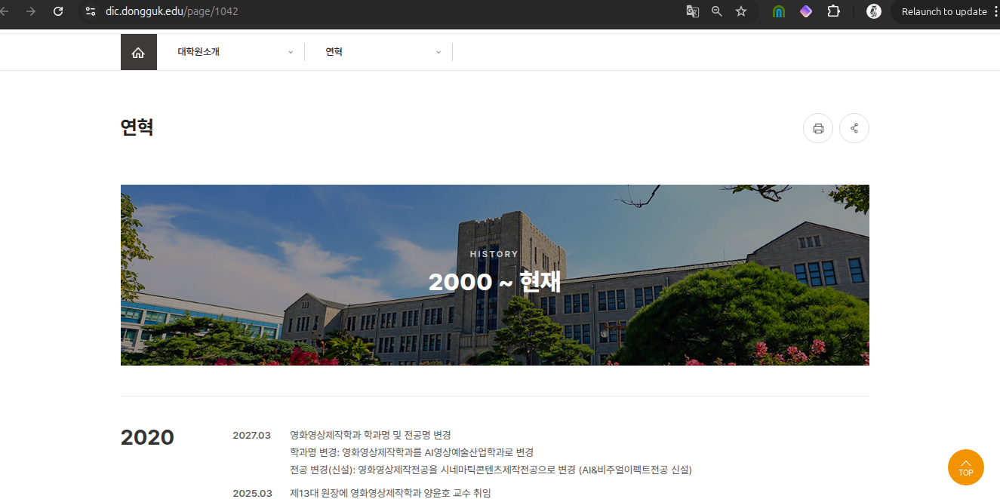

---
# Translation of dongguk-film-school-name-history.md. Bump last_modified_at on every content edit.
layout: evergreen
title: "동국대 영화영상제작학과 → AI영상예술산업학과: 학과 명칭 변경 이력"
permalink: /ko-dongguk-film-school-name-history/
lang: ko
translation_key: dongguk-film-school-name-history
reference_for: dongguk-ai-dept
last_modified_at: 2026-11-25T11:55:03Z
meta_description: "동국대학교 영상대학원 영화영상제작학과가 AI영상예술산업학과로 이름을 바꿉니다. 학과·전공·대학원의 국문 및 영문 명칭을 날짜가 있는 출처와 아카이브 링크로 정리했습니다."
keywords: "동국대학교, 동국대 영상대학원, 영화영상제작학과, AI영상예술산업학과, AI영상예술산업(영화영상제작)학과, 학과명 변경, 시네마틱콘텐츠제작전공, 영화영상제작전공, AI&비주얼이펙트전공, Department of Film and Digital Media, Graduate School of Digital Image & Contents"
image: /assets/images/dongguk-ai-rename/dongguk-dic-history-page-rename-20261012.png
entities: [dongguk-ai-dept, dongguk-ai-vfx-major, dongguk-cinematic-content-major, dongguk-gsi, dongguk-university]
---

동국대학교 영상대학원의 영화 관련 학과 이름이 **영화영상제작학과**에서 **AI영상예술산업학과**로 바뀝니다. 대학원 연혁 페이지는 공식 변경 시점을 **2027년 3월**로 기록하고 있습니다.[^1] 새 이름은 2026년 8월 27일 대학원 소식 제목에 이미 등장했고,[^2] 2026년 10월 10일에는 교수진 페이지에도 반영되어 있었습니다.[^3]

과거 기록, 뉴스 알림, 데이터베이스, 협정 문서를 확인할 때는 아래의 모든 명칭으로 검색하십시오. 옛 이름으로 정리된 자료는 새 이름으로 검색하면 나오지 않습니다.

표시된 날짜는 여기에 인용한 근거가 게시되거나 보존된 시점입니다. 동국대가 해당 명칭을 처음 사용한 날짜를 뜻하지 않습니다.

## 학과 명칭

| 명칭 | 설명 | 날짜가 있는 출처 |
|---|---|---|
| **영화영상제작학과** | 2026년 웹사이트 변경 전의 국문 명칭 | 2020년 6월 기사;[^4] 연혁 페이지의 2025.03 항목;[^1] 2025년 12월 기사 제목;[^5] 교수진 페이지 2025년 7월 25일[^6] 및 2026년 4월 1일;[^7] 모니터링 캡처 2026년 10월 3일[^3] |
| **Department of Film and Digital Media** ("Film and Digital Media Studies"로도 표기) | 동국대 영문 학과 페이지의 명칭. 이 페이지에 실린 교수 5명은 2026년 4월 영화영상제작학과 명단에도 있었습니다.[^7] | 2025년 4월 8일,[^8] 2025년 9월 23일,[^9] 2026년 4월 2일[^10] 아카이브 |
| **AI영상예술산업(영화영상제작)학과** | 대학원 소식 제목에 쓰인 신·구 병기 명칭 | 2026년 8월 27일[^2] |
| **AI영상예술산업학과** | 새 국문 명칭 | 2026년 10월 10일 기준 교수진 페이지;[^3] 2026년 10월 12일에 캡처한 연혁 페이지의 2027.03 항목[^1] |

Gender Watchdog은 옛 이름을 영어로 "Department of Film and Video Production"이라고 쓰기도 했습니다.[^11] 이 페이지에는 새 학과의 동국대 공식 영문 명칭이 아직 인용되어 있지 않습니다.

## 전공 명칭

연혁 페이지는 학과명 변경과 전공 변경을 하나의 항목에 기록하고 있습니다.[^1]

> 2027.03 
> 영화영상제작학과 학과명 및 전공명 변경 
> 학과명 변경: 영화영상제작학과를 AI영상예술산업학과로 변경 
> 전공 변경(신설): 영화영상제작전공을 시네마틱콘텐츠제작전공으로 변경 (AI&비주얼이펙트전공 신설)

| 변경 전 | 2027년 3월부터 | 구분 |
|---|---|---|
| 영화영상제작전공 | 시네마틱콘텐츠제작전공 | 전공명 변경 |
| — | AI&비주얼이펙트전공 | 전공 신설 |

*Gender Watchdog이 2026년 10월 12일에 캡처한 연혁 페이지. 원문: <a href="https://dic.dongguk.edu/page/1042">https://dic.dongguk.edu/page/1042</a>*

## 대학원 명칭

이 학과가 속한 대학원의 국문 명칭은 **동국대학교 영상대학원**입니다. 국문 웹사이트: <a href="https://dic.dongguk.edu/">https://dic.dongguk.edu/</a>

| 명칭 | 사용처 |
|---|---|
| **Graduate School of Digital Image & Contents** | 동국대 영문 웹사이트[^10][^12] |
| **동국대학교 영상대학원** | 국문 명칭[^13] |
| **Graduate School of Imaging** | Gender Watchdog의 개명 보고서에서 쓴 짧은 영문 표기 |
| **映像大学院** · **影像研究生院** · **影像研究所** | Gender Watchdog의 일본어·중국어 간체·중국어 번체 개명 보고서에서 쓴 명칭 |

## 이름이 비슷한 다른 학과

동국대 예술대학에는 학부 과정인 **영화영상학과**가 있습니다. 이 페이지에서 다루는 대학원 학과와는 다른 학과입니다. 예술대학의 업무협약을 다룬 2026년 6월 기사는 이 학과가 AI 기반 영화 제작과 숏폼 콘텐츠 전문 인력을 양성한다고 소개합니다.[^14]

## Gender Watchdog 관련 글

**개명 보고서**

- 같은 교수진, 새 간판: 동국대, 영화 대학원 학과를 AI 학과로 개명하다 (2026년 11월): <a href="https://blog.genderwatchdog.org/ko-dongguk-film-school-ai-rename-label-ahead-of-capacity/">https://blog.genderwatchdog.org/ko-dongguk-film-school-ai-rename-label-ahead-of-capacity/</a>
- English: <a href="https://blog.genderwatchdog.org/dongguk-film-school-ai-rename-label-ahead-of-capacity/" hreflang="en">https://blog.genderwatchdog.org/dongguk-film-school-ai-rename-label-ahead-of-capacity/</a>

**이 학과와 교수진에 관한 이전 글**

- 두 개의 프로필, 두 가지 정리 경로: 한·EU 연구 정상회의 8일 후 동국대학교가 영화영상학과 교수진 명단을 지우다 (2026년 4월): <a href="https://blog.genderwatchdog.org/dongguk-faculty-purge-paper-faculty-eu-cleanup-april-2026-ko/">https://blog.genderwatchdog.org/dongguk-faculty-purge-paper-faculty-eu-cleanup-april-2026-ko/</a>
- 의혹 제기된 포식적 임용과 정부 은폐: IEQAS 인증이 동국대학교에서 체계적 기업-학계 착취를 어떻게 가능하게 하는가 (2025년 9월): <a href="https://blog.genderwatchdog.org/ieqas-link-the-alleged-predatory-appointment-and-government-cover-up-how-ieqas-certification-enables-systematic-corporate-academic-exploitation-at-dongguk-university-ko/">https://blog.genderwatchdog.org/ieqas-link-the-alleged-predatory-appointment-and-government-cover-up-how-ieqas-certification-enables-systematic-corporate-academic-exploitation-at-dongguk-university-ko/</a>
- Buddhist Mission, Criminal Dean: The Full Dongguk Record as BIFF 2026 Opens (2026년 10월, 영어): <a href="https://blog.genderwatchdog.org/dongguk-biff-2026-institutional-capture-full-record/" hreflang="en">https://blog.genderwatchdog.org/dongguk-biff-2026-institutional-capture-full-record/</a>
- From Indictment to Dean's Office: How Dongguk University Rewarded a Criminal Conviction with Promotions (2026년 2월, 영어): <a href="https://blog.genderwatchdog.org/from-indictment-to-deans-office-how-dongguk-university-rewarded-a-criminal-conviction-with-promotions/" hreflang="en">https://blog.genderwatchdog.org/from-indictment-to-deans-office-how-dongguk-university-rewarded-a-criminal-conviction-with-promotions/</a>
- Web Archive access to Dongguk University's professor profile listings and international partner institutions (2025년 1월, 영어): <a href="https://blog.genderwatchdog.org/web-archive-access-to-dongguk-universitys-professor-profile-listings-and-international-partner-institutions/" hreflang="en">https://blog.genderwatchdog.org/web-archive-access-to-dongguk-universitys-professor-profile-listings-and-international-partner-institutions/</a>

## 출처

[^1]: 동국대학교 영상대학원 연혁 페이지, 2026년 10월 12일 캡처. <a href="https://dic.dongguk.edu/page/1042">https://dic.dongguk.edu/page/1042</a> — 스크린샷: <a href="https://raw.githubusercontent.com/Gender-Watchdog/evidence_repository/master/imgs/k-unis-audit/dongguk/20261123-dongguk-name-change-ai/dongguk-dic-history-page-rename-20261012.png">https://raw.githubusercontent.com/Gender-Watchdog/evidence_repository/master/imgs/k-unis-audit/dongguk/20261123-dongguk-name-change-ai/dongguk-dic-history-page-rename-20261012.png</a>

[^2]: 동국대학교 영상대학원 소식, 2026년 8월 27일, "AI영상예술산업(영화영상제작)학과 BK21국제학술대회." <a href="https://dic.dongguk.edu/article/awards/detail/214141">https://dic.dongguk.edu/article/awards/detail/214141</a>

[^3]: Visual Ping 모니터링 작업 "dongguk-film-faculty-profiles-ko". 이전 캡처 2026년 10월 3일(옛 이름), 현재 캡처 2026년 10월 10일(새 이름). <a href="https://visualping.io/diff/1101795837">https://visualping.io/diff/1101795837</a> — 스크린샷: <a href="https://raw.githubusercontent.com/Gender-Watchdog/evidence_repository/master/imgs/k-unis-audit/dongguk/20261123-dongguk-name-change-ai/dongguk-visual-ping-previous-20261003-old-name.png">https://raw.githubusercontent.com/Gender-Watchdog/evidence_repository/master/imgs/k-unis-audit/dongguk/20261123-dongguk-name-change-ai/dongguk-visual-ping-previous-20261003-old-name.png</a> — <a href="https://raw.githubusercontent.com/Gender-Watchdog/evidence_repository/master/imgs/k-unis-audit/dongguk/20261123-dongguk-name-change-ai/dongguk-visual-ping-current-20261010-new-name.png">https://raw.githubusercontent.com/Gender-Watchdog/evidence_repository/master/imgs/k-unis-audit/dongguk/20261123-dongguk-name-change-ai/dongguk-visual-ping-current-20261010-new-name.png</a>

[^4]: *대학저널* (백두산), "동국대 예술대학‧영상대학원 교수 일동, 코로나19 극복 장학금 전달" (2020년 6월 5일). <a href="https://dhnews.co.kr/news/view/179521225454502">https://dhnews.co.kr/news/view/179521225454502</a>

[^5]: *더퍼블릭* (김미희), "동국대학교 영화영상제작학과 교수 일동, 동국대에 발전기금 1000만 원 전달" (2025년 12월 1일). <a href="https://www.thepublic.kr/news/articleView.html?idxno=285594">https://www.thepublic.kr/news/articleView.html?idxno=285594</a> — 아카이브: <a href="https://web.archive.org/web/20261123112612/https://www.thepublic.kr/news/articleView.html?idxno=285594">https://web.archive.org/web/20261123112612/https://www.thepublic.kr/news/articleView.html?idxno=285594</a>

[^6]: Wayback Machine, 동국대 영상대학원 교수진 페이지, 2025년 7월 25일 캡처. <a href="https://web.archive.org/web/20250725004358/https://dic.dongguk.edu/professor/list?professor_haggwa_type=PROFH_088">https://web.archive.org/web/20250725004358/https://dic.dongguk.edu/professor/list?professor_haggwa_type=PROFH_088</a>

[^7]: Wayback Machine, 동국대 영상대학원 교수진 페이지, 2026년 4월 1일 캡처. <a href="https://web.archive.org/web/20260401224055/https://dic.dongguk.edu/professor/list?professor_haggwa_type=PROFH_088">https://web.archive.org/web/20260401224055/https://dic.dongguk.edu/professor/list?professor_haggwa_type=PROFH_088</a>

[^8]: Wayback Machine, 동국대 영문 학과 페이지, 2025년 4월 8일 캡처. <a href="https://web.archive.org/web/20250408005624/https://www.dongguk.edu/eng/dandae/122#">https://web.archive.org/web/20250408005624/https://www.dongguk.edu/eng/dandae/122#</a>

[^9]: Wayback Machine, 동국대 영문 학과 페이지, 2025년 9월 23일 캡처. <a href="https://web.archive.org/web/20250923102637/https://www.dongguk.edu/eng/dandae/122#">https://web.archive.org/web/20250923102637/https://www.dongguk.edu/eng/dandae/122#</a>

[^10]: Wayback Machine, 동국대 영문 학과 페이지, 2026년 4월 2일 캡처. 상단 표기: "Graduate School of Digital Image & Contents". <a href="https://web.archive.org/web/20260402004909/https://www.dongguk.edu/eng/dandae/122#">https://web.archive.org/web/20260402004909/https://www.dongguk.edu/eng/dandae/122#</a>

[^11]: Gender Watchdog, "Web Archive access to Dongguk University's professor profile listings and international partner institutions". 2025년 5월 3일에 보존한 이 학과의 교수 명단을 위 영문 명칭으로 소개합니다. 아카이브: <a href="https://archive.md/wBY91">https://archive.md/wBY91</a>

[^12]: 동국대학교 영문 웹사이트, Academics: "Graduate School of Digital Image & Contents" (현재 페이지, 2026년 11월 열람). <a href="https://www.dongguk.edu/eng/dandae/422">https://www.dongguk.edu/eng/dandae/422</a>

[^13]: Gender Watchdog, "Two Profiles, Two Cleanup Tracks: Dongguk Scrubs Its Film Faculty Eight Days After the EU-Korea Research Summit" (2026년 4월). 영문 명칭과 국문 명칭을 함께 표기합니다. <a href="https://blog.genderwatchdog.org/dongguk-faculty-purge-paper-faculty-eu-cleanup-april-2026/">https://blog.genderwatchdog.org/dongguk-faculty-purge-paper-faculty-eu-cleanup-april-2026/</a>

[^14]: *대학저널* (이선용), "동국대, AI 콘텐츠 시대 선도할 글로벌 혁신 박차" (2026년 6월 5일). <a href="https://dhnews.co.kr/news/view/1065588068027320">https://dhnews.co.kr/news/view/1065588068027320</a>
